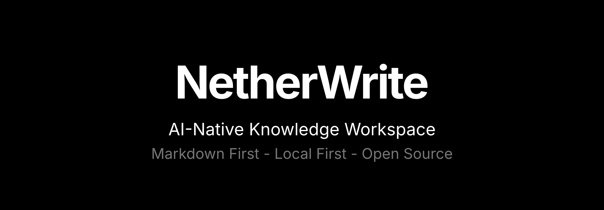

# NetherWrite

<p align="center">
  
</p>

<p align="center">
  <strong>A local-first, AI-assisted knowledge workspace for Markdown vaults.</strong>
</p>

<p align="center">
  <a href="LICENSE"></a>
  
  
  
  
</p>

NetherWrite is a professional desktop knowledge management app built around plain Markdown files, Obsidian-style workflows, graph navigation, local semantic indexing, and optional cloud collaboration. It is designed for people who want ownership of their notes while still having a modern thinking layer for search, synthesis, writing assistance, and knowledge exploration.

The app is built with Electron, React, TypeScript, CodeMirror, D3, Tailwind CSS, Transformers.js, IndexedDB, and Supabase.

## Why NetherWrite

NetherWrite is for writers, researchers, engineers, students, and teams who want a serious knowledge base without surrendering their files to a proprietary silo.

| Principle | What it means |
| --- | --- |
| Local-first by default | Notes are normal files in normal folders. Core workflows work offline. |
| Markdown-native | Your writing stays portable, readable, and tool-friendly. |
| AI where it helps | Retrieval, suggestions, summaries, and inline writing tools are grounded in your vault. |
| Cloud when you choose | Supabase-backed sync, collaboration, and public Spaces are optional. |
| Plugin-aware | NetherWrite targets Obsidian plugin compatibility through a tested runtime layer. |

## To start using NetherWrite

You do not need an account, a cloud project, or an API key to write. There is no shipped phone app. Current release is **[v1.0.5](https://github.com/varshithm7x/NetherWrite/releases/tag/v1.0.5)**.

A **vault** is any folder you choose. Your notes are the `.md` files in that folder. NetherWrite reads them; it does not lock them in a database. Cache and indexes go in a `.netherwrite` folder inside the vault — you can ignore that folder in git.

Stuck after install? [Open an issue](https://github.com/varshithm7x/NetherWrite/issues) or ask in [Discussions](https://github.com/varshithm7x/NetherWrite/discussions).

### Install

Pick your OS. Linux packages on this release are **x86_64**.

**Windows**

- [Installer](https://github.com/varshithm7x/NetherWrite/releases/download/v1.0.5/NetherWrite.Setup.1.0.5.exe) — run `NetherWrite.Setup.1.0.5.exe`
- [Portable](https://github.com/varshithm7x/NetherWrite/releases/download/v1.0.5/NetherWrite.1.0.5.exe) — no installer; run the `.exe`

Signed by [SignPath.io](https://signpath.io/) / [SignPath Foundation](https://signpath.org/).

```powershell
Invoke-WebRequest -Uri https://github.com/varshithm7x/NetherWrite/releases/download/v1.0.5/NetherWrite.Setup.1.0.5.exe -OutFile NetherWrite.Setup.1.0.5.exe
```

**macOS**

Apple menu → About This Mac → Chip. If it says Apple, use Apple Silicon. If it says Intel, use Intel.

- Apple Silicon — [NetherWrite-1.0.5-arm64.dmg](https://github.com/varshithm7x/NetherWrite/releases/download/v1.0.5/NetherWrite-1.0.5-arm64.dmg)
- Intel — [NetherWrite-1.0.5.dmg](https://github.com/varshithm7x/NetherWrite/releases/download/v1.0.5/NetherWrite-1.0.5.dmg)

Open the `.dmg`, drag **NetherWrite** into **Applications**, then launch it from there.

```bash
# Apple Silicon
curl -LO https://github.com/varshithm7x/NetherWrite/releases/download/v1.0.5/NetherWrite-1.0.5-arm64.dmg

# Intel
curl -LO https://github.com/varshithm7x/NetherWrite/releases/download/v1.0.5/NetherWrite-1.0.5.dmg
```

If Gatekeeper blocks the app: right-click → Open, or `xattr -cr /Applications/NetherWrite.app`.

**Linux**

- [AppImage](https://github.com/varshithm7x/NetherWrite/releases/download/v1.0.5/NetherWrite-1.0.5.AppImage)
- Debian / Ubuntu — [netherwrite_1.0.5_amd64.deb](https://github.com/varshithm7x/NetherWrite/releases/download/v1.0.5/netherwrite_1.0.5_amd64.deb)
- Arch — [netherwrite-1.0.5-1-x86_64.pkg.tar.zst](https://github.com/varshithm7x/NetherWrite/releases/download/v1.0.5/netherwrite-1.0.5-1-x86_64.pkg.tar.zst)

There is no official `.rpm`.

```bash
# AppImage
curl -LO https://github.com/varshithm7x/NetherWrite/releases/download/v1.0.5/NetherWrite-1.0.5.AppImage
chmod +x NetherWrite-1.0.5.AppImage
./NetherWrite-1.0.5.AppImage

# Debian / Ubuntu
curl -LO https://github.com/varshithm7x/NetherWrite/releases/download/v1.0.5/netherwrite_1.0.5_amd64.deb
sudo dpkg -i netherwrite_1.0.5_amd64.deb

# Arch
curl -LO https://github.com/varshithm7x/NetherWrite/releases/download/v1.0.5/netherwrite-1.0.5-1-x86_64.pkg.tar.zst
sudo pacman -U netherwrite-1.0.5-1-x86_64.pkg.tar.zst
```

**macOS and Linux — one command** (detects the OS and installs the matching package):

```bash
curl -fsSL https://raw.githubusercontent.com/varshithm7x/NetherWrite/main/scripts/install.sh | bash
```

### First launch

The welcome screen can **create a new folder** or **open an existing one**. That folder is the vault.

- New to this: create an empty folder. You will add notes inside the app.
- Coming from Obsidian: open the folder you already use. Notes, `[[wiki links]]`, tags, and `.canvas` files stay on disk. You can keep using Obsidian on the same folder.
- Switch later with **File → Open Vault**. `Ctrl/Cmd+O` is the note switcher, not “open another vault.”

No account. Writing works offline.

### First session

1. `Ctrl/Cmd+N` — new note. Type. `Ctrl/Cmd+S` saves the `.md` file in the vault.
2. Link notes with `[[other-note]]`.
3. `Ctrl/Cmd+O` jumps to a note by name. `Ctrl/Cmd+Shift+F` searches file contents. `Ctrl/Cmd+P` is the command palette.
4. `Ctrl/Cmd+G` opens the graph (your wiki links as a map).
5. Open **Spaces**, create a local Space, and ask a question over the folder. The first time may download the on-device embedding model; after that, retrieval stays local. Answers that call a remote model need an OpenAI or OpenRouter key in Settings. Local embeddings do not.

| Keys | What it does |
| --- | --- |
| `Ctrl/Cmd+N` | New note |
| `Ctrl/Cmd+S` | Save |
| `Ctrl/Cmd+O` | Jump to a note |
| `Ctrl/Cmd+Shift+F` | Search the vault |
| `Ctrl/Cmd+P` | Command palette |
| `Ctrl/Cmd+G` | Graph |

### AI and optional cloud

| You want | What you set up |
| --- | --- |
| Write, search, graph | Nothing |
| Local Spaces (index the folder, retrieve with citations) | Nothing. Model caches on first use. |
| Inline rewrite / Spaces answers from a remote model | Your OpenAI or OpenRouter key in Settings |
| Sync Spaces across machines | Your own Supabase project (see [To start developing](#to-start-developing-netherwrite)) |
| Live multiplayer editing | Sign in, create or link a private cloud space, and invite collaborators |

Community plugins go through an Obsidian-compatible runtime. Compatibility is tested; it is not a promise that every plugin is perfect.

## To start developing NetherWrite

You need [Node.js](https://nodejs.org/) 22 or newer and npm 9+. You do **not** need this if you only want to use the desktop app above.

```bash
git clone https://github.com/varshithm7x/NetherWrite.git
cd NetherWrite
npm install
npm run dev
```

That builds the Electron main process, starts Vite at `http://localhost:5173`, and launches the desktop app.

If Electron’s postinstall download was skipped:

```bash
npm config set ignore-scripts false
npm rebuild electron
npm run dev
```

| Command | Purpose |
| --- | --- |
| `npm run dev` | Desktop app + Vite |
| `npm run lint` | Typecheck (`tsc --noEmit`) |
| `npm run test` | Unit tests |
| `npm run test:plugin-runtime` | Plugin API runtime tests |
| `npm run test:all-checks` | Full contributor gate |
| `npm run package` | Local installers in `release/` |

Platform packages: `npm run package:mac`, `package:win`, `package:linux`. Tagged GitHub releases are built by [`.github/workflows/release.yml`](.github/workflows/release.yml). Distro templates are in [`packaging/`](packaging/).

Optional Spaces sync uses [`.env.example`](.env.example) → `.env.local` (`VITE_SUPABASE_URL`, `VITE_SUPABASE_ANON_KEY`) and [`supabase/schema.sql`](supabase/schema.sql). Local vaults, search, graph, and local Spaces need no environment variables.

The website is a separate Vite app:

```bash
cd website
npm install
npm run dev
```

## Website

The product site and user guide live in [`website/`](website/). Run it locally with the commands above. [netherwrite.dev](https://netherwrite.dev) is a **placeholder** — do not treat that URL as live docs until it is.

Contributor technical notes: [`docs/`](docs/README.md) (Spaces internals, plugin API matrix).

## Contributing

We love our contributors. If you want to help, start with [CONTRIBUTING.md](CONTRIBUTING.md). Fork, branch from `main`, keep the change small, run `npm run lint` and the tests that match what you touched, then open a pull request against `varshithm7x/NetherWrite`.

This community has a [Code of Conduct](CODE_OF_CONDUCT.md). Please follow it.

Good first issues are labeled [`good first issue`](https://github.com/varshithm7x/NetherWrite/issues?q=is%3Aissue+is%3Aopen+label%3A%22good+first+issue%22).

## Our Roadmap

What is shipped, what is next, and what is later: [docs/roadmap.md](docs/roadmap.md). The living backlog is [GitHub Issues](https://github.com/varshithm7x/NetherWrite/issues).

## Getting in touch

- [GitHub Issues](https://github.com/varshithm7x/NetherWrite/issues) — bugs and features
- [GitHub Discussions](https://github.com/varshithm7x/NetherWrite/discussions) — questions
- [netherwrite@gmail.com](mailto:netherwrite@gmail.com) — project contact
- Security reports: [SECURITY.md](SECURITY.md) (not the public tracker)

##  Contributors

<a href="https://github.com/varshithm7x/NetherWrite/graphs/contributors">
  
</a>

## License

[Apache License 2.0](LICENSE).
